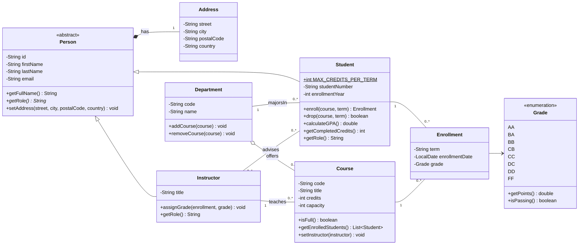

# Student Class Diagram – Mapping Design to Code

**Course:** Software Engineering – Software Implementations
**Assignment:** Mapping Design to Code
**Language:** Java 17+

This repository takes a UML class diagram of a university **Student** system and maps it,
element by element, to Java source code.

---

## 1. Class Diagram (Design)

GitHub renders the diagram below automatically. The same diagram is in
[`docs/student-class-diagram.puml`](docs/student-class-diagram.puml) (PlantUML).



---

## 2. Mapping Rules (Design → Code)

| UML element | Diagram example | Java mapping | Where in code |
|---|---|---|---|
| Class | `Course` | `public class Course` | `Course.java` |
| Abstract class | `«abstract» Person` | `public abstract class Person` | `Person.java` |
| Abstract operation | `getRole()*` | `public abstract String getRole();` | `Person.java` |
| Enumeration | `«enumeration» Grade` | `public enum Grade` | `Grade.java` |
| Private attribute (`-`) | `-String email` | `private String email;` + getter/setter | all classes |
| Public operation (`+`) | `+calculateGPA()` | `public double calculateGPA()` | `Student.java` |
| Static member (underlined / `$`) | `MAX_CREDITS_PER_TERM` | `public static final int` | `Student.java` |
| Generalization (`<|--`) | `Person <|-- Student` | `class Student extends Person` | `Student.java`, `Instructor.java` |
| Composition (`*--`) | `Person *-- Address` | Owner **creates** the part inside itself; part's constructor is package-private | `Person.setAddress(...)` |
| Aggregation (`o--`) | `Department o-- Course` | Whole holds a `List<Course>`; parts are created elsewhere and **passed in** | `Department.addCourse(...)` |
| Association, multiplicity `1` / `0..1` | `Course → 1 Instructor` | Single reference field | `Course.instructor` |
| Association, multiplicity `0..*` | `Instructor → 0..* Course` | `List<Course>` field, exposed as unmodifiable list | `Instructor.courses` |
| Bidirectional association | `Instructor — Course` | Both ends hold references; one setter updates both sides | `Course.setInstructor(...)`, `Student.setDepartment(...)` |
| Association class | `Enrollment` between `Student` and `Course` | Separate class holding both references + link data (term, grade) | `Enrollment.java` |
| Constraints / business rules | credit limit, capacity, duplicate enrollment | Validation in methods, `IllegalStateException` | `Student.enroll(...)`, `Course.addEnrollment(...)` |

### Design decisions
- **Encapsulation:** every attribute is `private`; collections are returned via
  `Collections.unmodifiableList(...)` so callers cannot break the associations.
- **Controlled creation:** `Enrollment` and `Address` constructors are package-private, so
  they can only be created through `Student.enroll(...)` and `Person.setAddress(...)`,
  exactly as the diagram's ownership implies.
- **Consistency of bidirectional links:** setters such as `setInstructor`, `setDepartment`
  and `setAdvisor` update both ends of the association.
- **GPA** is a weighted average: `Σ(grade points × credits) / Σ credits`.

---

## 3. Project Structure

```
student-class-diagram/
├── README.md
├── docs/
│   └── student-class-diagram.puml
└── src/main/java/com/university/
    ├── Main.java                 # demo of all classes & relationships
    └── model/
        ├── Person.java           # abstract superclass
        ├── Address.java          # composition part
        ├── Student.java          # extends Person
        ├── Instructor.java       # extends Person
        ├── Department.java       # aggregation whole
        ├── Course.java
        ├── Enrollment.java       # association class
        └── Grade.java            # enumeration
```

---

## 4. How to Run

```bash
javac -d out $(find src -name "*.java")
java -cp out com.university.Main
```

### Sample output
```
=== Department ===
CENG - Computer Engineering | courses: 2 | students: 2

=== Students ===
Student[P-100, Ali Demir]
  Address : Ataturk Cad. No:10, 34000 Istanbul, Turkey
  Advisor : Dr. Ayse Yilmaz
  2023001 -> CENG301 [2026-Fall] AA
  2023001 -> CENG302 [2026-Fall] BB
  GPA     : 3.55 | completed credits: 11
Student[P-101, Zeynep Arslan]
  Address : -
  Advisor : Dr. Ayse Yilmaz
  2023002 -> CENG301 [2026-Fall] CB
  GPA     : 2.50 | completed credits: 6

=== Course rosters ===
CENG301 Software Engineering (6 cr) - Dr. Ayse Yilmaz -> 2 student(s)
CENG302 Database Systems (5 cr) - Prof. Mehmet Kaya -> 1 student(s)

=== Business rules ===
Blocked duplicate enrollment: Ali Demir is already enrolled in CENG301 for 2026-Fall
Blocked wrong instructor: Prof. Mehmet Kaya does not teach CENG301
```
